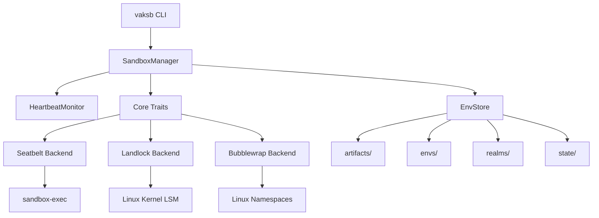

# System Design Document

## Executive Summary

Current implementation includes macOS process containment and durable retained Realms with bounded execution, paged review, fingerprint-bound promotion, backups, conflict checks, explicit recovery, latest-promotion rollback and destruction. The durable owner is `RealmStore`; OS containment uses the process backend. Snapshots are review manifests, not restorable checkpoints. Linux and stronger resource quotas remain unsupported. This document also contains target architecture; the [runbook](../operations/RUNBOOK.md) and [README](../../README.md#current-implementation-status) define the supported path.

## Problem Statement

Agent systems need to execute arbitrary code safely. Current solutions fall into two categories:
1. **Process sandboxes** (e.g., seccomp, Seatbelt) - Restrict syscalls/filesystem/network but don't provide safe ways to apply changes back to host
2. **VM/Container isolation** - Heavyweight, complex, not suitable for fine-grained agent workflows
3. **Copy-based workspaces** - Lack crash safety, atomic promotion, rollback

vak-sandbox combines lightweight OS sandboxing with a transactional promotion model inspired by database transactions and version control.

## Design Goals

| Goal | Rationale | Priority |
|------|-----------|----------|
| Deny by default | Zero-trust security model | P0 |
| Crash safety | System crashes must not corrupt host workspace | P0 |
| Path traversal protection | Prevent sandbox escapes | P0 |
| Reviewable promotion | Human/agent review before applying changes | P0 |
| Minimal dependencies | Reduce attack surface | P0 |
| Cross-platform foundation | macOS first, Linux support planned | P1 |
| Observable/auditable | Full audit trail of operations | P1 |
| CoW efficiency | Minimize disk usage | P2 |

## Non-Goals

- Full VM isolation (use containers/VMs for that)
- Network firewalling beyond OS primitives
- GUI/application sandboxing beyond process execution
- Distributed execution

## Architecture

### High-Level Design



### Layer Responsibilities

| Layer | Responsibility | Dependencies |
|-------|---------------|--------------|
| **Core** | Traits, policies, path validation, errors | serde, thiserror only |
| **Env** | Environment store, hashing, materialization | core, sha2, walkdir, tar, zstd |
| **Backends** | OS-specific sandbox implementation | core, tokio process APIs |
| **Runtime** | Orchestration, lifecycle, heartbeat | core, env, backends |
| **CLI** | User interface | runtime, env, clap |

## Core Abstractions

### 1. SandboxBackend Trait

The backend trait defines the contract for all sandbox implementations. Using async traits with `Pin<Box<dyn Future>>` for object safety and dynamic dispatch.

```rust
pub trait SandboxBackend: Send + Sync {
    fn id(&self) -> &str;
    fn name(&self) -> &str;
    fn platforms(&self) -> &[&str];
    fn available(&self) -> bool;
    fn capabilities(&self) -> BackendCaps;
    fn create_process(&self, plan: &ProcessPlan) -> Pin<Box<dyn Future<Output = Result<Box<dyn SandboxEnv>>> + Send + '_>>;
    fn create_realm(&self, plan: &RealmPlan) -> Pin<Box<dyn Future<Output = Result<Box<dyn SandboxEnv>>> + Send + '_>>;
}
```

**Design Rationale**: Trait objects allow runtime backend selection without monomorphization overhead in hot paths, and enable future RPC-based backends.

### 2. Policy System

Deny-by-default policy with four orthogonal concerns:

```rust
pub struct Policy {
    pub fs: FsPolicy,        // Filesystem access control
    pub network: NetworkPolicy, // Network access control  
    pub env: EnvPolicy,      // Environment variable filtering
    pub resources: ResourcePolicy, // Resource limits
}
```

#### Filesystem Policy
- `allow_read`: Explicit read allowlist
- `allow_write`: Explicit write allowlist (implies read in practice)
- `deny`: Override denylist (takes precedence)
- `follow_symlinks`: Disabled by default (dangerous)

#### Network Policy
All network access denied by default. Granular controls:
- `allow`: Master switch
- `allow_outbound`/`allow_inbound`: Directional control
- `allow_localhost`: Local IPC
- `allow_hosts`: Specific hosts/IPs
- `allow_ports`: Specific ports
- `allow_dns`: DNS resolution

#### Environment Policy
- `allow`: Set of variable names permitted
- `set`: Variables to inject

**Critical**: Empty allow set means no variables passed. Never inherit `std::env`.

#### Resource Policy
Defaults are conservative (2GB RAM, 1 hour CPU, 2 hours wall, 256 processes, 1GB files).

### 3. Path Confinement Algorithm

Path confinement is the most security-critical component. Algorithm:

```
function confined(root, relative):
  1. Validate relative is not absolute -> error if absolute
  2. Validate no ".." components -> error if found
  3. Canonicalize root (must exist)
  4. current = root
  5. For each component in relative:
     a. If CurDir skip
     b. If ParentDir -> error (should not happen after check)
     c. If Normal(name):
        - current = current/name
        - stat = symlink_metadata(current)
        - if exists and is_symlink -> error SymlinkEscape
        - if not exists -> ok (new file allowed)
        - if other error -> error
  6. Return current
```

**Why component-wise**: We check each path component for symlinks as we traverse, preventing symlink attacks where a later component creates a symlink.

**TOCTOU consideration**: We check at validation time. For promotion operations, additional checks occur at apply time with locks.

## Environment Store Design

### Content-Addressable Storage

All artifacts keyed by SHA256 hex digest:
- **Deduplication**: Same artifact used by multiple envs stored once
- **Integrity**: Hash verified on put and before use
- **Immutability**: Artifacts never modified after storage

### Materialization Strategy

**Goal**: Fast realm creation with minimal disk usage

**macOS (preferred)**: `cp -cR` uses APFS clonefile for copy-on-write
- Space efficient: only modified blocks copied
- Fast: metadata-only operation
- Fallback to regular copy if CoW unavailable

**Linux**: Regular copy, hardlinks attempted where possible
- Future: use `cp --reflink=auto` for btrfs/xfs CoS

**Hardened base**: After materialization, walk tree and remove write permissions (mode & 0o555) except writable layer.

### Layout Rationale

```
~/.cache/vak-sandbox/
├── artifacts/  # Global artifact cache (shared across all envs)
├── envs/       # Extracted/prepared base environments
├── realms/     # Per-realm instances (ephemeral)
└── state/      # Manager state, journals, locks
```

Separating artifacts/envs/realms allows independent garbage collection policies.

## Runtime Management

### SandboxManager

Central orchestrator maintaining realm state:
- `realms: Arc<RwLock<HashMap<String, RealmHandle>>>` - In-memory state
- `heartbeat: Arc<HeartbeatMonitor>` - Liveness tracking
- `store: Arc<EnvStore>` - Environment storage

**Thread safety**: RwLock for realm map (read-heavy), async-aware.

### Heartbeat Protocol

```rust
pub struct Heartbeat {
    pub realm_id: String,
    pub timestamp: u64,  // Unix seconds
    pub pid: Option<u32>,
    pub load: f32,
    pub mem_mb: u64,
    pub alive: bool,
}
```

Monitor checks `last_seen.elapsed() < timeout` for liveness. Default 30s timeout, stale detection separates "not responding" from "dead".

### Control Protocol

Message-passing protocol for coordination:
- `Ping` -> `Pong`: Health check
- `Exec`: Command execution request
- `Snapshot`: Create snapshot of realm state
- `Promote`: Initiate promotion (journaled)
- `Destroy`: Clean up realm
- `Status`: Query realm status

Designed for future IPC/remote management.

## Security Architecture

### Defense in Depth Layers

1. **Input validation**: All paths through `confined()`
2. **Policy enforcement**: Deny-by-default, explicit allowlists
3. **OS sandbox**: Seatbelt/Landlock/bubblewrap
4. **Environment filtering**: Strict env allowlist
5. **Profile injection protection**: Safe quoting in Seatbelt
6. **Audit trail**: (planned) Log all operations

### Seatbelt Profile Generation

Critical security: never interpolate untrusted strings directly.

```rust
fn sbpl_quote(s: &str) -> String {
    let mut out = String::with_capacity(s.len() + 2);
    out.push('"');
    for c in s.chars() {
        match c {
            '\\' => out.push_str("\\\\"),
            '"' => out.push_str("\\\""),
            _ => out.push(c),
        }
    }
    out.push('"');
    out
}
```

Profile structure:
```
(version 1)
(deny default)                    # Deny everything first
(allow process-exec)              # Minimal process ops
(allow process-fork)
(allow file-read* (subpath ...))   # Explicit reads
(allow file-write* (subpath ...))  # Explicit writes
(allow network-... )              # Explicit network if enabled
```

### Threat Mitigations

| Threat | Mitigation | Status |
|--------|-----------|--------|
| Path traversal (`../`) | Component check rejects ParentDir | ✅ |
| Absolute paths | Rejected at validation | ✅ |
| Symlink escapes | Component-wise symlink detection | ✅ |
| Profile injection | Safe quoting + char validation | ✅ |
| Env leakage | Allowlist only | ✅ |
| Network exfiltration | Deny by default | ✅ |
| Resource exhaustion | ResourcePolicy limits | ⚠️ Defined, not enforced |
| TOCTOU | Canonicalization + locks (planned) | Partial |

## Future Design: Promotion System

### Transactional Promotion (Planned)

Inspired by Vak/code's model:

```
1. Journal: Record all changes with hashes
2. Backup: Copy affected files from workspace
3. Validate: Re-check paths, conflicts
4. Apply: Atomic operations where possible
5. Verify: Check integrity
6. Commit: Mark journal complete
   OR
   Rollback: Restore from backups on failure
```

**Journal location**: Outside workspace (in `state/`) to survive corruption.

**Crash recovery**: On startup, scan incomplete journals and offer rollback/complete.

## Performance Considerations

- **CoW materialization**: O(1) metadata copy on APFS
- **Path validation**: O(depth) per path, cached where safe
- **Heartbeat**: Lock-free reads where possible
- **Async I/O**: Non-blocking throughout

## Testing Strategy

- **Unit tests**: Core logic (path, policy, hash)
- **Integration tests**: Manager, store, full workflows
- **Security tests**: Attack vectors (traversal, symlinks, injection)
- **Platform tests**: macOS + Linux in CI/Docker
- **Property tests**: (planned) Fuzz path confinement

## References

- [sandbox-runtime](https://github.com/anthropic-experimental/sandbox-runtime) - Inspiration for process sandboxing
- [vak/code](https://github.com/nranjan2code/code) - Inspiration for promotion model
- [Seatbelt Man Page](https://www.manpagez.com/man/7/sandboxd/)
- [Landlock Documentation](https://landlock.io/)
